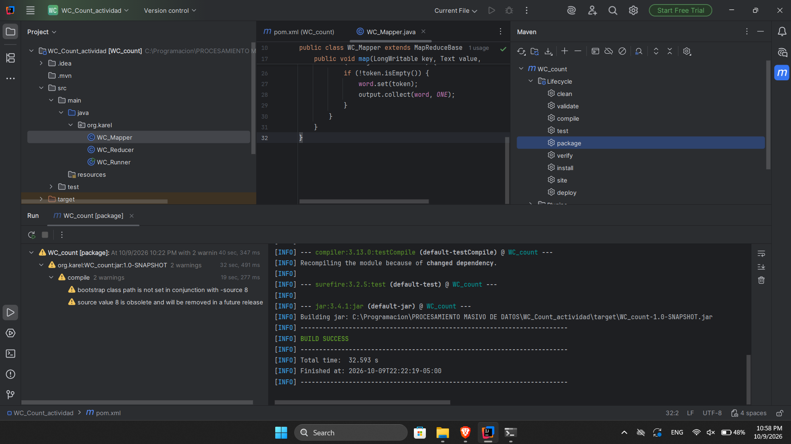
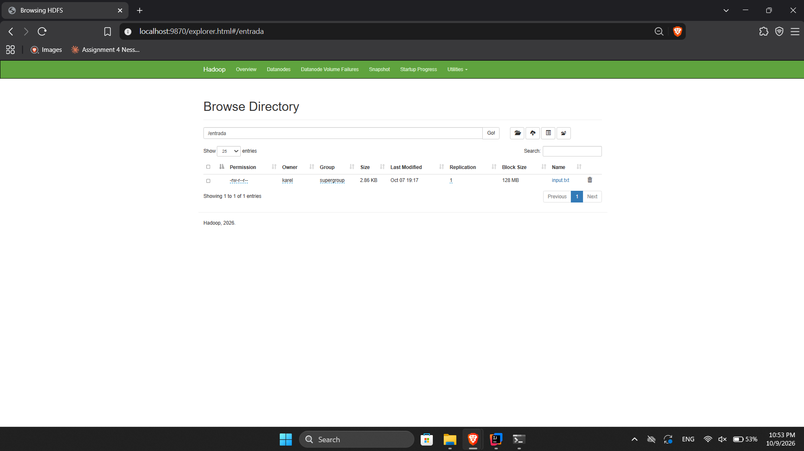

# WordCount en Hadoop — normalización de palabras

Proyecto académico de **procesamiento masivo de datos** que implementa un conteo de palabras con **Apache Hadoop MapReduce**. Se modificó el programa WordCount para que el conteo **no distinga mayúsculas y minúsculas** y **no considere signos de puntuación como parte de las palabras**.

## Objetivo

Procesar un texto en HDFS y calcular la frecuencia de aparición de cada palabra, aplicando estas reglas:

- Convertir las palabras a minúsculas (`Hadoop`, `HADOOP` y `hadoop` → `hadoop`).
- Utilizar caracteres especiales y puntuación como separadores (`datos,` y `datos.` → `datos`).
- Conservar letras con tildes y `ñ` (`análisis`, `información`, `máquinas`).
- Contabilizar cada palabra mediante las etapas **Mapper** y **Reducer**.

Ejemplo de entrada:

```text
Hadoop, HADOOP! hadoop.
Datos, DATOS datos.
```

Resultado esperado:

```text
datos\t3
hadoop\t3
```

## Tecnologías utilizadas

- Java (configuración de compilación de Maven: Java 8).
- Apache Hadoop **3.5.0** (HDFS, YARN y MapReduce).
- Apache Maven.
- IntelliJ IDEA.
- Ubuntu sobre WSL2 para la ejecución local.

## Estructura del repositorio

```text
.
├── README.md
├── .gitignore
├── pom.xml
├── src/
│   └── main/java/org/karel/
│       ├── WC_Mapper.java
│       ├── WC_Reducer.java
│       └── WC_Runner.java
├── entrada/
│   └── input.txt
├── resultados/
│   └── resultado_wordcount.txt
└── evidencias/
    ├── 01_Compilacion_Maven_BUILD_SUCCESS.png
    ├── 02_HDFS_Entrada_input_txt.png
    ├── 03_HDFS_Salida_SUCCESS_y_part_00000.png
    ├── 04_Conteo_Parte_1_A_C.png
    ├── 05_Conteo_Parte_2_D_F.png
    ├── 06_Conteo_Parte_3_F_N.png
    ├── 07_Conteo_Parte_4_M_S.png
    └── 08_Conteo_Parte_5_S_Z.png
```

Los directorios generados por IntelliJ y Maven (como `.idea/` y `target/`) no se incluyen en GitHub: el JAR se reconstruye con Maven.

## Cómo funciona

1. **`WC_Mapper`** convierte el texto a minúsculas y separa las palabras mediante la expresión regular `[^\\p{L}\\p{N}]+`, que trata como separador cualquier secuencia de caracteres que no sean letras ni números. Emite cada palabra acompañada de `1`.
2. **`WC_Reducer`** suma los valores asociados a cada palabra.
3. **`WC_Runner`** configura y ejecuta el trabajo MapReduce. También emplea el Reducer como *combiner*.

Fragmento clave del Mapper:

```java
String line = value.toString().toLowerCase(Locale.ROOT);
String[] tokens = line.split("[^\\p{L}\\p{N}]+");

for (String token : tokens) {
    if (!token.isEmpty()) {
        word.set(token);
        output.collect(word, ONE);
    }
}
```

> La puntuación actúa como separador; no se fusionan palabras que estén a ambos lados de un signo. Las tildes se conservan (por ejemplo, `mas` y `más` se considerarían palabras distintas).

## Compilación y ejecución

**Requisito previo:** tener Maven y un entorno Hadoop configurado y operativo, con HDFS y YARN iniciados. En la instalación utilizada para esta actividad, los servicios se inician con `start-hadoop`.

Desde la carpeta raíz del proyecto:

```bash
mvn clean package
```

Se genera `target/WC_count-1.0-SNAPSHOT.jar`.

Crear la carpeta de entrada en HDFS y subir el archivo:

```bash
hdfs dfs -mkdir -p /entrada
hdfs dfs -put entrada/input.txt /entrada/
```

> Si `/entrada/input.txt` ya existe, no necesitas volver a subirlo.

Ejecutar el trabajo:

```bash
hadoop jar target/WC_count-1.0-SNAPSHOT.jar org.karel.WC_Runner /entrada /salida_final
```

**Importante:** Hadoop exige que la carpeta de salida (`/salida_final`) **no exista** antes de ejecutar el trabajo. Si ya existe, utiliza otra ruta, por ejemplo `/salida_nueva`.

Visualizar el resultado:

```bash
hdfs dfs -ls /salida_final
hdfs dfs -cat /salida_final/part-00000
```

Guardar el resultado fuera de HDFS:

```bash
hdfs dfs -getmerge /salida_final resultado_wordcount.txt
```

En la ejecución documentada, el archivo se llamó **`part-00000`** (no `part-r-00000`).

## Resultados obtenidos

Se procesó el archivo [`entrada/input.txt`](entrada/input.txt). El resultado real de Hadoop está en [`resultados/resultado_wordcount.txt`](resultados/resultado_wordcount.txt).

| Métrica | Resultado |
|---|---:|
| Palabras diferentes | **193** |
| Apariciones totales | **423** |
| Frecuencia de `datos` | **21** |
| Frecuencia de `procesamiento` | **6** |

HDFS generó los archivos `_SUCCESS` y `part-00000` dentro de `/salida_final`, confirmando la finalización del trabajo.

## Evidencias de la actividad

**Compilación Maven:**



**Archivo de entrada en HDFS (`/entrada`):**



**Salida en HDFS (`/salida_final`):**


Las capturas `04` a `08` de la carpeta [`evidencias/`](evidencias/) muestran el conteo en la terminal, organizado alfabéticamente.

## Nota

Este repositorio documenta una **actividad académica** de WordCount. Para reproducirla en otro equipo, se requiere una instalación funcional de Hadoop; no basta con ejecutar el proyecto Java como una aplicación convencional.
